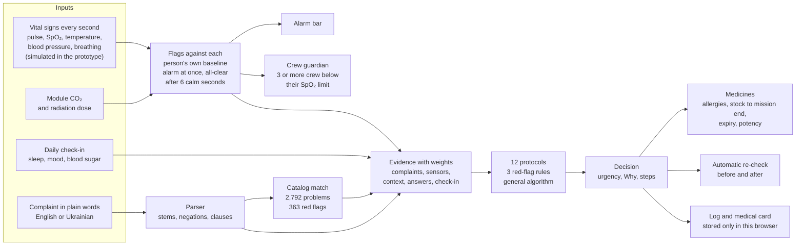

# Asklepios: an offline AI medic for a crew on its way to Mars

**NASA Space Apps Challenge 2026** · Local event: Dnipro, Ukraine · Challenge: **Create Health Monitoring Software for Astronauts on Space Missions**

**Team vod0laz1:** Maksym (captain), Dmytro (structural engineer), Denys (designer), Matvii (front-end developer), Stanislav (back-end developer)

**Live app:** https://kalagan1337.github.io/asklepios/ · **30-second demo:** https://kalagan1337.github.io/asklepios/Asklepios-demo-30s-EN.mp4

Українська версія: [README.uk.md](README.uk.md)

## What it is

On the way to Mars, a doctor’s answer takes up to 44 minutes round trip, and for about two weeks around solar conjunction there is no contact at all. There is no doctor on board, only a crew medical officer with short training, no evacuation, and no resupply of medicines.

Asklepios is health-monitoring and decision-support software that lives on board. It:

- watches each astronaut’s vital signs against **their own baseline** and raises an alarm when a value needs attention;
- asks every crew member for a **daily check-in** (sleep, mood, blood sugar) and shows **7-day color-coded trends**;
- turns a complaint typed **in plain English or Ukrainian** into an **explained decision**: urgency, the evidence behind it, treatment steps, medicines from the onboard kit and an automatic re-check;
- covers what a long mission needs: a pharmacy forecast to the end of the mission, a mode for when the medical officer is the patient, training alarms, and a crew guardian that acts when nobody can.

Everything is **one HTML file (1.44 MB)** that runs in any modern browser with **no internet, no server and no installation**. The interface is in English and Ukrainian.

## Files

| File | What it is |
|---|---|
| `Asklepios.html` | **The app.** Double-click to open it in Chrome, Edge or Firefox. Works offline. Language: UA / EN at the top. |
| `index.html` | Only forwards to `Asklepios.html`, so the website address opens the app. |
| `presentation.html` | Full deck, 14 slides, English and Ukrainian. → or a click: next; the left edge: back; L: language; F: full screen. |
| `pitch-7-slides.html` | 7-slide English deck (title included), the alternative project demo. |
| `defense.html` | 5-slide deck for the live defense, English and Ukrainian: `?lang=uk` or `?lang=en` (or L) picks the language. |
| `Asklepios-demo-30s-EN.mp4` | The 30-second demo (29.6 s), English subtitles, silent. |
| `Asklepios-video-EN.mp4` | The full film (1:48), English subtitles, silent. |
| `screenshots/` | Five 1920×1080 screenshots of the English app. |
| `LICENSE` | MIT license. |

## Start here

On first open the app shows a **“Start here”** window with five choices; each one starts at once:

1. **CO₂ build-up**: CO₂ rises in the lab, the monitor raises the alarm, the AI medic asks questions and explains its decision.
2. **Describe a complaint**: examine anyone in the crew; type what is wrong in your own words.
3. **Training alarm**: someone suddenly gets worse; you have 2 minutes to help.
4. **Problem catalog**: 2,792 health problems, search in your own words.
5. **Depressurization**: the crew is unconscious, so the ship acts on its own.

“Just look around” closes the window; the **Start here** button in the header opens it again. The footer says: *“Prototype. Vital signs are simulated. Not medical advice.”*

**A three-minute tour:** Start here → **CO₂ build-up** → when the red alarm appears, **Examine** → type `I feel dizzy, it is hard to breathe, no nausea` → Enter → **Next →** → “Do others in this module feel the same?” **Yes** → **Show decision →** → read **Why** and open **How the system decided** → tick the four steps (start with “Move to a module with normal air”) → the re-check says the vitals are back to normal. Then click **Illia’s** line “Check-in: not yet · sleep ↓ · mood ↓” in the crew column to see his 7-day trends, and search the **Problem catalog** for `blocked ear` or `chest pain`.

## How Asklepios answers the challenge

The challenge suggests tracking *“blood pressure, heart rate, blood sugar, body temperature, daily sleep hours, and mood.”* Asklepios tracks all six:

| Indicator | How Asklepios measures it | What it does with it |
|---|---|---|
| **Heart rate** | Every second for each person (simulated wearable stream), with a 90-second chart and a dashed line at the person’s baseline | Caution above max(105, baseline + 45) bpm; alarm above max(140, baseline + 75) or below 40; an “irregular rhythm” flag; evidence for the heart-rhythm and other protocols |
| **Blood pressure** | Systolic/diastolic for each person, shown on the crew card (simulated; in flight a cuff from the medical kit) | Alarm below 90 systolic, caution above 150; high pressure counts as evidence in kidney colic; below 85 makes the decision life-threatening |
| **Blood sugar** | Optional field of the daily check-in, 40–400 mg/dL | Caution below 70 or above 180, alarm below 54 or above 250; an out-of-range value raises the exam’s urgency and shows three simple steps (re-check; 15 g of fast sugar if low or water and no sweets if high; call the medical officer) |
| **Body temperature** | Every second for each person | Caution at max(37.8, baseline + 1.1) °C, alarm at max(39, baseline + 2.0) °C; a baseline up to 38.2 °C is accepted because resting temperature rises in flight (“space fever”) |
| **Daily sleep hours** | Daily check-in slider, 0–14 h | Caution below 6 h, alarm below 4.5 h; two short nights out of the last three count as evidence for the *Sleep disorder* protocol |
| **Mood** | Daily check-in, five drawn faces from “Very bad” to “Great” | Caution at 2 or lower, alarm at 1; a low mood raises any decision to at least “Needs medical officer” and suggests talking to the medical officer or psychological support |

It also follows SpO₂, breathing rate, CO₂ in each module and each person’s radiation dose.

The challenge’s other questions:

- **Which measurements can be done in space?** Wearable signals (heart rate, SpO₂, breathing, skin temperature, as on CSA’s Astroskin), a cuff, a thermometer and a glucometer from the medical kit, and a one-minute check-in.
- **Why is an exam needed?** Numbers alone do not tell a headache from a CO₂ problem. The 4-step exam (Patient → Complaints → Questions → Decision) combines complaints, sensors, mission context and answers.
- **How do spaceflight hazards change the indicators?** Each demo scenario and the check-in carry a tag naming the NASA HRP hazard it illustrates (table below), and the protocols use the context: CO₂ in the module, the flight day, a recent spacewalk, a solar proton event.
- **When does a result need the crew or the flight surgeon?** Status colors (Normal, Caution, Alarm) on every reading, and four urgency levels on every decision: *Self-care*, *Needs medical officer*, *Urgent*, *Life-threatening*.
- **What actions prevent a critical condition?** Step-by-step treatment checklists, medicines checked against allergies and stock, an automatic re-check, and training alarms that rehearse the response.
- **Interface:** animated live charts, color coding, a daily reminder (“Daily check-in: 4 of 4 haven’t checked in yet”), a graded 2-minute training game, and a simple mode with short steps and large text.

## Features

| Part | What it does |
|---|---|
| Crew monitor | Four crew members on the ship “Argo”, day 214 of an 860-day mission. Pulse, SpO₂ and temperature every second; blood pressure, breathing and the daily radiation dose under each card. Limits come from each person’s baseline. An alarm appears at once and clears only after 6 calm seconds, so it does not flicker. |
| Daily check-in | Sleep, mood, optional blood sugar and a note, once per mission day. A reminder at the top of the crew column, a line on each crew card, an overview with the last 7 days as colored squares, and for each person three 7-day charts (sleep bars with a 6 h line, mood faces over an amber band, sugar dots over the 70–180 band). Six earlier days of example data are included and labeled. |
| Exam in 4 steps | Complaints in plain English or Ukrainian. The parser handles word stems, negations (“no nausea”, “I don’t have a headache but…”), clauses split by commas and “but”, and matching against the catalog. |
| Explained decision | Urgency level, a **Why** line, and **How the system decided**: every piece of evidence with its weight and source (complaint, sensor, context, answer, daily check-in), plus what was ruled out. Then a checklist of steps, medicines and an automatic before-and-after re-check. |
| Knowledge base | 12 onboard protocols, 3 red-flag rules (possible head injury, anaphylaxis, heart attack) and a general algorithm for everything else. A protocol is named only with enough evidence (35% or more, with objective support where needed); otherwise the screen says “The cause is not clear yet” and lists up to three possibilities. |
| Problem catalog | 2,792 health problems in 15 body sections, 14,240 search phrasings in Ukrainian and 15,444 in English, best matches first, A–Z index, one-typo tolerance. 363 entries are marked life-threatening and 841 urgent; they raise the urgency automatically. The crew can add their own problems. |
| Medical card | Records per person: problem, severity 1–10, onset, note; filters by person; the daily check-in block. |
| People | Add, edit or remove crew members: role, module, allergies (penicillins, NSAIDs) and personal baselines. A new person appears everywhere at once. |
| Pharmacy for the whole mission | 17 items. Courses on board against courses needed until the end of the mission, allergy substitutes (for example levofloxacin instead of amoxicillin/clavulanate for a penicillin allergy), expiry dates and an approximate radiation-potency model. |
| “The medic is ill” | When the patient is the crew medical officer, a simple mode for a helper with no training: short steps, large text, dose lines, and “The commander decides after consulting Earth”, or “at once” in an emergency. |
| Test mode | A training alarm: who, what (suffocation from CO₂ build-up, arrhythmia, kidney colic, decompression) and when. Without help the patient gets worse. The test passes only when the right protocol is running, all its steps are ticked and the vitals are back to normal. Grades: Excellent, Good, Just in time, Too late, with a breakdown. |
| Crew guardian | If at least 3 people (or the whole crew, if smaller) fall below their SpO₂ limit and nobody responds, a 6-second countdown with an “I am conscious” button; then the ship sounds the siren, closes the hatches, isolates the leak in the airlock and supplies oxygen from reserve. |
| Readiness | A 5-try reaction test before docking, a spacewalk or robotic-arm work, compared with the person’s baseline and sensors. |
| Log | Alarms, decisions, steps and check-ins of the current session. |

## NASA Human Research Program: five hazards, five answers

| Hazard (NASA HRP) | What Asklepios does about it | Where to see it |
|---|---|---|
| Space radiation | Radiation background and each person’s daily dose; the *Solar flare* scenario (proton event, shelter, acute radiation reaction protocol); radiation-potency model for medicines | Air and radiation panel, crew cards, Pharmacy |
| Isolation and confinement | Daily check-in: sleep and mood with 7-day trends and a daily reminder; a low mood raises the exam’s urgency | Crew column, Medical card |
| Distance from Earth | All decisions are made on board, offline; a pharmacy for the whole mission; *The medic is ill* mode; training alarms | Everywhere; Demo scenarios; Test tab |
| Gravity fields | Protocols for vision change (SANS), back pain, kidney stones (*Kidney colic* scenario) and heart rhythm (*Arrhythmia* scenario) | Exam, Demo scenarios |
| Hostile closed environments | *CO₂ build-up*, the *Depressurization* guardian, *Decompression after a spacewalk* | Start here, Demo scenarios |

In the app each scenario, the test mode and the daily check-in carry a small tag such as “NASA HRP: hostile closed environments”.

## Architecture

- **Classic, explainable AI:** a rule-based expert system with a weighted-evidence inference engine. The confidence shown is the protocol’s share of the evidence points, damped when there is little evidence; it is not a calibrated probability. When two options are close, the more dangerous one sets the urgency.
- **One file:** HTML, CSS and plain JavaScript with no libraries, no external fonts and no network calls. Data (records, people, check-ins, custom problems, test history, language) stays in the browser’s localStorage on that computer; “Clear all data” in the Demo scenarios menu removes it.
- **Simulation:** a 1-second tick drives a physiology model per person; speed ×1, ×10 or ×60.

## Validation (measured by the team on the final build)

Measured on 14 November 2026 on the final `Asklepios.html` (1,447,424 bytes) in headless Chrome, with a scripted test that drives the real app:

| Check | Result |
|---|---|
| Scenario complaints → the expected protocol (6 demo scenarios + 4 training alarms) | **10 / 10** |
| Free complaints, normal sensors, 18 Ukrainian + 12 English phrases → a safe decision* | **30 / 30** |
| CO₂ build-up demo path | alarm after 10 simulation ticks (about 9 s in real time); “Excess CO₂ and low oxygen”, Urgent, confidence 75–83% depending on when the exam starts; re-check “better: readings are back to normal” about 5 s after the first step |
| Network requests while running | **0** (only the file itself is opened) |
| Console errors and exceptions | **0** |
| Size | **1.44 MB**, one file, no dependencies |

\* Safe means: the right protocol, a red-flag decision, or the general algorithm at a fitting urgency; “no complaint recognized” only for phrases where nothing is wrong. The criteria were written per phrase before scoring.

Confidence per scenario and the 30 free complaints

Scenarios: CO₂ build-up 82%, The medic is ill 71%, Arrhythmia 40%, Decompression after a spacewalk 79%, Kidney colic 53%, Solar flare 71%. Training alarms: suffocation 80%, arrhythmia 55%, kidney colic 53%, decompression 79%.

| Phrase (Ukrainian phrases with an English gloss) | Decision | Urgency |
|---|---|---|
| «голова паморочиться, важко дихати, нудоти немає» (dizzy, hard to breathe, no nausea) | The cause is not clear yet | Urgent |
| «болить голова» (headache) | The cause is not clear yet | Needs medical officer |
| «не болить голова, але нудить» (no headache, but nauseous) | A symptom without an onboard protocol | Needs medical officer |
| «болить у грудях, віддає в ліву руку» (chest pain going to the left arm) | Possible heart attack | Life-threatening |
| «тисне в грудях, холодний піт» (chest pressure, cold sweat) | Possible heart attack | Life-threatening |
| «вдарився головою, тепер хочеться спати» (hit my head, now sleepy) | Possible head injury | Life-threatening |
| «болить живіт справа внизу і температура» (lower right belly pain and fever) | Infection with fever | Urgent |
| «опік руки окропом» (scalded hand) | A symptom without an onboard protocol | Needs medical officer |
| «набрякли губи, висип і важко дихати після таблетки» (swollen lips, rash, hard to breathe after a pill) | Possible anaphylaxis | Life-threatening |
| «не можу помочитися» (cannot pass urine) | A symptom without an onboard protocol | Urgent |
| «болить зуб» (toothache) | A symptom without an onboard protocol | Needs medical officer |
| «поганий настрій, нічого не хочеться, не бачу сенсу» (low mood, see no point) | A symptom without an onboard protocol | Needs medical officer |
| «порізав палець, кров не зупиняється» (cut finger, bleeding will not stop) | A symptom without an onboard protocol | Life-threatening |
| «немає сил і морозить» (no strength, chills) | Infection with fever | Needs medical officer |
| «не можу дихати» (cannot breathe) | The cause is not clear yet | Urgent |
| «кашель з кров’ю» (coughing blood) | The cause is not clear yet | Life-threatening |
| «все добре, нічого не болить» (all good, nothing hurts) | No complaint recognized | none |
| «закладає вухо» (blocked ear) | A symptom without an onboard protocol | Needs medical officer |
| I feel dizzy, it is hard to breathe, no nausea | The cause is not clear yet | Urgent |
| crushing chest pain going to my left arm | Possible heart attack | Life-threatening |
| I hit my head and now I feel sleepy | Possible head injury | Life-threatening |
| pain in my lower right belly and a fever | Infection with fever | Urgent |
| my lips are swollen, rash and hard to breathe after a pill | Possible anaphylaxis | Life-threatening |
| I can’t pee | A symptom without an onboard protocol | Urgent |
| I don’t have a headache but I feel sick | A symptom without an onboard protocol | Needs medical officer |
| no fever, no cough, just tired | The cause is not clear yet | Needs medical officer |
| I feel hopeless and can’t stop crying | A symptom without an onboard protocol | Urgent |
| burned my hand on a hot plate | A symptom without an onboard protocol | Urgent |
| toothache | A symptom without an onboard protocol | Needs medical officer |
| my ear feels blocked | A symptom without an onboard protocol | Needs medical officer |

With normal sensors and normal module air, “dizzy, hard to breathe” is not named as a CO₂ problem: that protocol needs objective support (high module CO₂, low SpO₂, fast breathing, or others in the module feeling the same).

This is engineering validation, not clinical validation. The next step is a set of standardized clinical cases reviewed by physicians.

## NASA data and resources

| Data or resource | Where it comes from | How Asklepios uses it |
|---|---|---|
| The five hazards of human spaceflight | NASA Human Research Program, [5 Hazards of Human Spaceflight](https://www.nasa.gov/hrp/hazards/) | The feature map of the whole product (table above); every scenario, the test mode and the daily check-in carry a “NASA HRP: …” tag |
| Human spaceflight risks | NASA HRP, [Risks of Human Spaceflight](https://www.nasa.gov/hrp/risks/) | Which conditions get an onboard protocol: vision change (SANS), kidney stones, decompression sickness, heart rhythm problems, sleep and behavioral health, radiation, in-flight medical conditions |
| Research done in flight | NASA HRP, [Ongoing HRP Research in Space](https://www.nasa.gov/hrp/ongoing-hrp-research/) | Background for what can be measured on board and why repeated, routine measurements matter |
| CO₂ limit: no more than 3 mmHg as a 1-hour average | NASA-STD-3001 and the NASA OCHMO [CO₂ technical brief](https://www.nasa.gov/wp-content/uploads/2023/03/co2-technical-brief-ochmo.pdf) | Module CO₂ above 3 mmHg is a caution flag and above 5 an alarm; in the decision it is +4 evidence, shown as “… mmHg vs NASA limit 3”; the *CO₂ build-up* scenario |
| CO₂ and headache: the odds roughly double with every extra 1 mmHg | Law et al., NASA JSC, 2014 ([summary](https://www.sciencedaily.com/releases/2014/05/140501100922.htm)) | Why module CO₂ is weighed as its own evidence |
| Radiation dose in cruise to Mars, about 1.8 mSv per day | Curiosity RAD measurements (Zeitlin et al., *Science*, 2013; [SwRI release](https://www.swri.org/press-release/swri-led-team-calculates-radiation-exposure-associated-trip-mars)) | Background of 75 µSv/h, which is 1.8 mSv per day; each person’s daily dose on the crew card; the approximate radiation-potency model of the pharmacy |
| Signal delay 3–22 minutes one way; a blackout of about 13 days at solar conjunction | NASA: [Mars 2020 communications](https://science.nasa.gov/missions/mars-2020-perseverance/speaking-percys-language-how-to-talk-so-perseverance-will-listen/), [Mars communications disruption and delay](https://www.nasa.gov/wp-content/uploads/2024/01/mars-communications-disruption-and-delay.pdf) | The reason everything runs on board; in an emergency the simple mode says the commander decides at once, because an answer from Earth takes up to 44 minutes |
| Health checks on the ISS are periodic, not continuous | NASA Glenn, [Exploration medical technologies](https://www.nasa.gov/glenn/glenn-expertise-space-exploration/human-health-performance/exploration-medical-technologies/multifunctional-integrated-medical-devices) | Why Asklepios watches continuously and adds a daily check-in |
| ISS medical kit contents | NASA [medical kit checklist](https://www.nasa.gov/wp-content/uploads/2015/03/medical_kit_checklist_-_full_release.pdf) | The pharmacy is modeled on drugs carried on the ISS (paracetamol, ibuprofen, ketorolac, tamsulosin, promethazine, ondansetron, levofloxacin, metoprolol, melatonin, adrenaline, diphenhydramine, aspirin); the kit’s blood pressure cuff and thermometer are the in-flight sources of those readings |
| Personal dosimetry | NASA SRAG, [Crew Active Dosimeter](https://srag.jsc.nasa.gov/spaceradiation/how/how.cfm) | The planned real source of each person’s dose |

## Space agency partner data

| Data or resource | Agency | How Asklepios uses it |
|---|---|---|
| [Monitoring Radiation for Astronaut Health](https://www.asc-csa.gc.ca/eng/news/articles/2026/2026-02-26-monitoring-radiation-astronaut-health.asp) (2026): neutrons are about 30% of the radiation on the ISS; the CANS instrument will measure them continuously and autonomously | CSA | Supports continuous, autonomous radiation monitoring instead of sessions; cited on the science slides |
| [Bio-Monitor](https://www.asc-csa.gc.ca/eng/sciences/bio-monitor.asp) / [Astroskin](https://www.asc-csa.gc.ca/eng/sciences/astroskin.asp) smart shirt, on the ISS since December 2018: ECG, breathing, skin temperature, pulse and SpO₂ from a headband sensor, about 48 h of battery | CSA | The simulated sensor stream is modeled on what Astroskin measures; it is the first real data source we would connect |
| [Why Do We Conduct Science Experiments in Space?](https://www.asc-csa.gc.ca/eng/iss/science/why-do-we-conduct-science-experiments-in-space.asp) | CSA | Background on how spaceflight changes the body |
| [Circadian Rhythms](https://www.esa.int/Science_Exploration/Human_and_Robotic_Exploration/Research/Keeping_the_rhythm_in_space) experiment and the Double Sensor for core body temperature; [Thermolab](https://www.dlr.de/en/latest/news/2009/20091015_from-charit-into-space-thermolab-experiment-starts-on-the-iss_20458/@@download/file) | ESA, DLR | The in-flight source for body temperature |
| “Space fever”: resting core temperature about 1 °C higher after months in orbit, above 40 °C during exercise (Stahn et al., *Scientific Reports*, 2017, [PMC5701078](https://pmc.ncbi.nlm.nih.gov/articles/PMC5701078)) | ESA / DLR / Charité study | Temperature limits are set from each person’s baseline, and a baseline up to 38.2 °C is accepted |

**Other references:** International Consensus on Time in Range (Battelino et al., *Diabetes Care*, 2019) for the 70–180, 54 and 250 mg/dL glucose limits; Barger et al., *Lancet Neurology*, 2014, on short sleep in flight (about 6 hours a night) as context for daily sleep tracking; Wotring, *AAPS Journal*, 2016, on medicines stored 550 days on the ISS.

## Limitations

- Vital signs and crew data are **simulated**; no real person’s data is used.
- The radiation-potency model for medicines is **approximate**. A NASA study of medicines kept 550 days on the ISS found no unusual degradation, so expiry dates (also tracked) matter more.
- The protocols are simplified and are **not medical advice**; this is not a medical device. Check-in limits are typical clinical ranges, not mission-certified ones.
- The problem catalog describes real symptoms, but it is **not an official medical reference**.
- Drug use rates and stock are our assumptions; a real system would take them from NASA’s Integrated Medical Model.
- The log lasts for the current session only.

## What’s next

1. Real sensors over Web Bluetooth (standard heart-rate chest straps), then an Astroskin-class wearable.
2. Pulse from the tablet camera (rPPG).
3. A small language model on the onboard computer for conversation, also offline; red flags and limits stay as rules.
4. Clinical review of the protocols with physicians, and a field test at a polar station or on a ship.
5. On Earth: polar stations, ships at sea and remote clinics have the same problem, help is far away.

## License, credits and tools

- Code and content: **MIT License**, © 2026 vod0laz1 (see `LICENSE`).
- No third-party code, libraries, fonts, images or music. Icons and graphics are inline SVG made for this project; the videos are screen recordings of the app with subtitles.
- NASA, CSA, ESA and other sources are cited above and are not redistributed. No NASA logos or other agency branding are used.
- Tools used: HTML, CSS and JavaScript, no libraries; headless Chrome and ffmpeg for the videos; an AI assistant (Claude by Anthropic) for code, catalog translation and media under the team’s direction.
