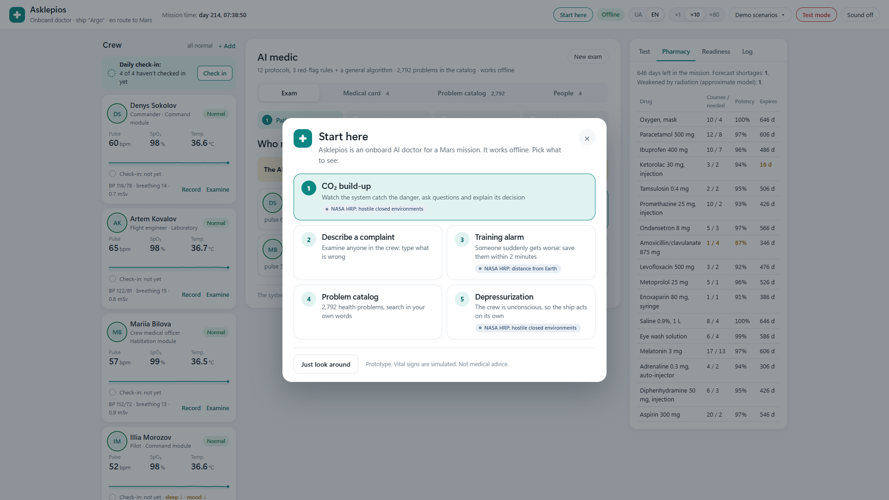

# Асклепій: офлайн ШІ-медик для екіпажу, що летить на Марс

**NASA Space Apps Challenge 2026** · Локальний етап: Дніпро, Україна · Завдання: **Create Health Monitoring Software for Astronauts on Space Missions**

**Команда vod0laz1:** Матвій (власник команди, front-end розробник), Максим (капітан), Дмитро (інженер структури), Денис (дизайнер), Станіслав (back-end розробник)

**Застосунок онлайн:** https://kalagan1337.github.io/asklepios/?lang=uk · **30-секундне демо:** https://kalagan1337.github.io/asklepios/Asklepios-demo-30s-EN.mp4

English version: [README.md](README.md)

## Що це

На шляху до Марса відповідь лікаря з Землі йде до 44 хвилин туди й назад, а приблизно два тижні під час сонячного з’єднання зв’язку немає взагалі. Лікаря на борту немає, лише медофіцер екіпажу з короткою підготовкою; евакуації немає, аптечку не поповнити.

Асклепій — програма для моніторингу здоров’я й підтримки рішень, яка живе на борту. Вона:

- стежить за показниками кожного астронавта щодо **його власної норми** й вмикає тривогу, коли показник потребує уваги;
- щодня просить кожного пройти **щоденну перевірку** (сон, настрій, цукор крові) і показує **тренди за 7 днів** із кольоровим кодуванням;
- перетворює скаргу, написану **звичайними словами українською чи англійською**, на **пояснене рішення**: терміновість, докази, кроки лікування, ліки з бортової аптечки й автоматичну повторну перевірку;
- покриває те, що потрібно в довгій місії: прогноз аптечки до кінця місії, режим, коли хворіє сам медофіцер, навчальні тривоги й вартового екіпажу, який діє, коли ніхто не може.

Усе це **один HTML-файл (1,44 МБ)**, що працює в будь-якому сучасному браузері **без інтернету, сервера й встановлення**. Інтерфейс українською та англійською.

## Файли

| Файл | Що це |
|---|---|
| `Asklepios.html` | **Застосунок.** Двічі клацніть: відкриється в Chrome, Edge або Firefox. Працює без інтернету. Мова: UA / EN угорі. |
| `index.html` | Лише перенаправляє на `Asklepios.html`, щоб адреса сайту відкривала застосунок. |
| `presentation.html` | Повна презентація, 14 слайдів, українською й англійською. → або клацання: далі; лівий край: назад; L: мова; F: повний екран. |
| `pitch-7-slides.html` | 7 слайдів англійською (разом із титульним) — альтернативне демо проєкту. |
| `defense.html` | 5 слайдів для захисту, українською й англійською: мову обирає `?lang=uk` або `?lang=en` (чи L). |
| `Asklepios-demo-30s-EN.mp4` | 30-секундне демо (29,6 с), англійські субтитри, без звуку. |
| `Asklepios-video-EN.mp4` | Повний фільм (1:48), англійські субтитри, без звуку. |
| `screenshots/` | П’ять знімків англійського інтерфейсу 1920×1080. |
| `LICENSE` | Ліцензія MIT. |

## З чого почати

Під час першого запуску застосунок показує вікно **«З чого почати»** з п’ятьма варіантами; кожен запускається одразу:

1. **Накопичення CO₂**: у лабораторії росте CO₂, монітор вмикає тривогу, ШІ-медик розпитує й пояснює рішення.
2. **Опишіть свою скаргу**: огляд будь-кого з екіпажу; напишіть своїми словами, що турбує.
3. **Навчальна тривога**: комусь раптово погано, на допомогу 2 хвилини.
4. **Каталог проблем**: 2 792 проблеми зі здоров’ям, пошук своїми словами.
5. **Розгерметизація**: екіпаж непритомний, корабель діє сам.

«Просто подивитися» закриває вікно; кнопка **«З чого почати»** вгорі відкриває його знову. Унизу вікна: *«Прототип. Показники симульовані. Не є медичною порадою.»*

**Маршрут на три хвилини:** «З чого почати» → **«Накопичення CO₂»** → коли з’явиться червона тривога, **«Оглянути»** → напишіть `голова паморочиться, важко дихати, нудоти немає` → Enter → **«Далі →»** → «Інші в цьому модулі відчувають те саме?» **«Так»** → **«Показати рішення →»** → прочитайте **«Чому»** й відкрийте **«Як система ухвалила рішення»** → відмітьте чотири кроки (першим «Перейти в модуль із нормальним повітрям») → повторна перевірка скаже, що показники повернулися до норми. Потім клацніть у колонці екіпажу рядок **Іллі** «Перевірка: ще ні · сон ↓ · настрій ↓», щоб побачити тренди за 7 днів, і пошукайте в **«Каталозі проблем»** `закладає вухо` або `біль у грудях`.

## Як Асклепій відповідає на завдання

Завдання радить стежити за такими показниками: *артеріальний тиск, пульс, цукор крові, температура тіла, години сну за добу й настрій.* Асклепій відстежує всі шість:

| Показник | Як вимірюється | Що з ним робить система |
|---|---|---|
| **Пульс** | Щосекунди для кожного (симульований потік із натільного датчика), графік за 90 секунд і пунктир на рівні особистої норми | Увага вище max(105, норма + 45), тривога вище max(140, норма + 75) або нижче 40; ознака «нерегулярний ритм»; доказ для протоколу порушення ритму та інших |
| **Артеріальний тиск** | Верхній і нижній для кожного, на картці екіпажу (симульовано; у польоті — манжета з аптечки) | Тривога, якщо верхній нижче 90, увага — вище 150; високий тиск — доказ при нирковій коліці; нижче 85 робить рішення «Загроза життю» |
| **Цукор крові** | Необов’язкове поле щоденної перевірки, 40–400 мг/дл | Увага нижче 70 або вище 180, тривога нижче 54 або вище 250; значення поза нормою підвищує терміновість огляду й показує три прості кроки |
| **Температура тіла** | Щосекунди для кожного | Увага від max(37,8, норма + 1,1) °C, тривога від max(39, норма + 2,0) °C; норму до 38,2 °C можна задати, бо в польоті температура в спокої зростає («космічна лихоманка») |
| **Години сну** | Повзунок щоденної перевірки, 0–14 год | Увага менше 6 год, тривога менше 4,5 год; дві короткі ночі з останніх трьох — доказ для протоколу «Порушення сну» |
| **Настрій** | Щоденна перевірка, п’ять намальованих облич від «Дуже погано» до «Чудово» | Увага при 2 і нижче, тривога при 1; низький настрій підвищує будь-яке рішення щонайменше до «Потрібен медофіцер» і радить поговорити з медофіцером або психологічною підтримкою |

Додатково система стежить за SpO₂, частотою дихання, CO₂ у кожному модулі й дозою радіації кожного.

Інші питання завдання:

- **Що можна виміряти в космосі?** Сигнали натільного датчика (пульс, SpO₂, дихання, температура шкіри, як в Astroskin Канадського космічного агентства), манжета, термометр і глюкометр з аптечки та хвилинна щоденна перевірка.
- **Навіщо огляд?** Самі числа не відрізнять звичайний головний біль від надлишку CO₂. Огляд у 4 кроки (Пацієнт → Скарги → Питання → Рішення) поєднує скарги, датчики, обставини місії та відповіді.
- **Як небезпеки польоту змінюють показники?** Кожен сценарій і щоденна перевірка мають позначку небезпеки NASA HRP (таблиця нижче), а протоколи враховують обставини: CO₂ у модулі, день польоту, нещодавній вихід у відкритий космос, сонячну протонну подію.
- **Коли результат потребує уваги екіпажу чи лікаря з Землі?** Кольори стану (Норма, Увага, Тривога) на кожному показнику й чотири рівні терміновості рішення: *Самодопомога*, *Потрібен медофіцер*, *Терміново*, *Загроза життю*.
- **Які дії запобігають критичному стану?** Покрокові плани лікування, ліки з перевіркою алергій і запасу, автоматична повторна перевірка й навчальні тривоги, що тренують реакцію.
- **Інтерфейс:** живі анімовані графіки, кольорове кодування, щоденне нагадування («Щоденна перевірка: 4 з 4 ще не відмітилися»), гра на 2 хвилини з оцінкою та простий режим із короткими кроками й великим текстом.

## Можливості

| Розділ | Що робить |
|---|---|
| Монітор екіпажу | Четверо на кораблі «Арго», день 214 із 860. Пульс, SpO₂ і температура щосекунди; тиск, дихання й доза за добу під кожною карткою. Межі рахуються від особистої норми. Тривога вмикається одразу, а знімається лише після 6 спокійних секунд, тож не мигає. |
| Щоденна перевірка | Сон, настрій, за бажанням цукор крові й нотатка, раз на день місії. Нагадування вгорі колонки екіпажу, рядок на картці кожного, огляд усіх із 7 останніми днями кольоровими квадратами, а для кожного — три графіки за 7 днів. Шість попередніх днів прикладу даних позначено. |
| Огляд у 4 кроки | Скарги звичайними словами українською чи англійською: основи слів, заперечення («нудоти немає»), поділ фрази на частини («але», “but”), пошук у каталозі. |
| Пояснене рішення | Рівень терміновості, рядок **«Чому»** і **«Як система ухвалила рішення»**: кожен доказ із вагою та джерелом (скарга, датчик, обставини, відповідь, щоденна перевірка) і що виключено. Далі кроки, ліки й автоматична повторна перевірка «до і після». |
| База знань | 12 бортових протоколів, 3 правила червоних прапорців (можлива черепно-мозкова травма, анафілаксія, інфаркт) і загальний алгоритм для решти. Протокол називається лише за достатніх доказів (від 35%, де потрібно — з об’єктивним підтвердженням); інакше система пише «Причина поки неясна» й показує до трьох можливих варіантів. |
| Каталог проблем | 2 792 проблеми в 15 розділах тіла, 14 240 формулювань для пошуку українською і 15 444 англійською, спершу найточніші, абетка, допуск однієї помилки. 363 записи позначено як загрозу життю, 841 — як термінові; вони автоматично підвищують терміновість. Екіпаж може додати свою проблему. |
| Медкартка | Записи кожного: проблема, сила 1–10, коли почалося, нотатка; фільтр за людиною; блок щоденної перевірки. |
| Люди | Додати, змінити, видалити: роль, модуль, алергії (пеніциліни, НПЗП) і особиста норма. Нова людина одразу з’являється всюди. |
| Аптечка на всю місію | 17 позицій. Курси на борту проти потрібних до кінця місії, заміна при алергії (наприклад, левофлоксацин замість амоксициліну/клавуланату), строки придатності й умовна модель втрати активності від радіації. |
| «Медик захворів» | Коли пацієнт — сам медофіцер, простий режим для помічника без підготовки: короткі кроки, великий текст, дози й «Рішення командира після консультації з Землею», а в екстреному випадку — «одразу». |
| Тестовий режим | Навчальна тривога: кому, що (задуха через накопичення CO₂, аритмія, ниркова коліка, декомпресія) і коли. Без допомоги стан погіршується. Тест пройдено, лише коли розпочато правильний протокол, відмічено всі кроки й показники повернулися до норми. Оцінки: Відмінно, Добре, Встигли в останню мить, Не встигли — і розбір. |
| Вартовий екіпажу | Якщо щонайменше троє (або весь менший екіпаж) опускаються нижче своєї межі SpO₂ і ніхто не відповідає — відлік 6 секунд із кнопкою «Я при тямі»; далі корабель вмикає сирену, зачиняє люки, ізолює витік у шлюзі й подає кисень із резерву. |
| Допуск | Тест реакції з 5 спроб перед стикуванням, виходом у відкритий космос або роботою маніпулятором, порівняно з особистою нормою й датчиками. |
| Журнал | Тривоги, рішення, кроки й перевірки поточного сеансу. |

## П’ять небезпек NASA HRP — п’ять відповідей

| Небезпека (NASA HRP) | Що робить Асклепій | Де побачити |
|---|---|---|
| Космічна радіація | Радіаційний фон і доза кожного за добу; сценарій «Сонячний спалах» (протонна подія, укриття, протокол гострої променевої реакції); модель активності ліків | Панель «Повітря і радіація», картки екіпажу, «Аптечка» |
| Ізоляція та замкнутий простір | Щоденна перевірка: сон і настрій із трендом за 7 днів і нагадуванням; низький настрій підвищує терміновість огляду | Колонка екіпажу, «Медкартка» |
| Віддаленість від Землі | Усі рішення на борту, без зв’язку; аптечка на всю місію; режим «Медик захворів»; навчальні тривоги | Усюди; «Сценарії демо»; вкладка «Тест» |
| Гравітаційні поля | Протоколи зміни зору (SANS), болю в спині, каменів у нирках (сценарій «Ниркова коліка») і ритму серця (сценарій «Аритмія») | «Огляд», «Сценарії демо» |
| Ворожі замкнені середовища | «Накопичення CO₂», вартовий «Розгерметизації», «Декомпресія після виходу» | «З чого почати», «Сценарії демо» |

## Архітектура

Схема — в англійській частині вище (розділ Architecture). Коротко: показники щосекунди → прапорці щодо особистої норми → тривога й вартовий; скарга звичайними словами → розбір мови → каталог → докази з вагами (скарги, датчики, обставини, відповіді, щоденна перевірка) → 12 протоколів, 3 червоні прапорці, загальний алгоритм → рішення, ліки, повторна перевірка → журнал і медкартка в браузері.

- **Класичний пояснюваний ШІ:** експертна система на правилах із механізмом зважування доказів. Відсоток «впевненості» — частка балів протоколу серед усіх варіантів, зменшена, коли доказів мало; це не калібрована ймовірність. Якщо два варіанти близькі, терміновість визначає небезпечніший.
- **Один файл:** HTML, CSS і JavaScript без бібліотек, без зовнішніх шрифтів і мережевих запитів. Дані зберігаються лише в localStorage браузера цього комп’ютера; «Очистити всі дані» в меню «Сценарії демо» їх видаляє.

## Перевірка (виміряно командою на фінальній збірці)

14 листопада 2026 року, фінальний `Asklepios.html` (1 447 424 байти), headless Chrome, скрипт керує справжнім застосунком:

- скарги зі сценаріїв → правильний протокол: **10 з 10** (6 сценаріїв + 4 навчальні тривоги);
- вільні скарги за нормальних датчиків, 18 українською й 12 англійською → безпечне рішення: **30 з 30** (повний список — в англійській частині);
- «Накопичення CO₂»: тривога через 10 тактів симуляції (близько 9 с); «Надлишок CO₂ і нестача кисню», «Терміново», впевненість 75–83% залежно від того, коли почати огляд; повторна перевірка «стало краще» приблизно через 5 с після першого кроку;
- мережевих запитів: **0**; помилок у консолі й винятків: **0**; розмір: **1,44 МБ**.

Це інженерна, а не клінічна перевірка. Наступний крок — стандартизовані клінічні випадки з лікарями.

## Дані NASA та партнерів

- **NASA HRP «5 Hazards of Human Spaceflight»** — карта функцій продукту й позначки «NASA HRP: …» у застосунку.
- **NASA HRP «Risks of Human Spaceflight»** — вибір бортових протоколів (SANS, камені в нирках, декомпресійна хвороба, ритм серця, сон і поведінкове здоров’я, радіація).
- **NASA HRP «Ongoing HRP Research in Space»** — контекст: що вимірюють у польоті.
- **NASA-STD-3001 / OCHMO**: CO₂ не більше 3 мм рт. ст. у середньому за годину — прапорець «Увага» понад 3, «Тривога» понад 5, доказ +4 у рішенні; кожен зайвий 1 мм рт. ст. приблизно подвоює шанси головного болю (Law et al., 2014).
- **Curiosity RAD**: близько 1,8 мЗв на добу в польоті до Марса — фон 75 мкЗв/год, доза кожного, модель активності ліків.
- **NASA**: затримка сигналу 3–22 хв в один бік і близько 13 днів без зв’язку під час сонячного з’єднання — тому все працює на борту.
- **NASA Glenn**: на МКС показники знімають періодично — тому безперервний моніторинг і щоденна перевірка.
- **Чек-лист аптечки МКС (NASA)** — основа списку ліків; **Crew Active Dosimeter (NASA SRAG)** — майбутнє джерело дози.
- **CSA «Monitoring Radiation for Astronaut Health» (2026)**: нейтрони — близько 30% радіації на МКС, прилад CANS вимірюватиме їх безперервно й автономно.
- **CSA Bio-Monitor / Astroskin** — на нього змодельовано потік датчиків; **CSA «Why Do We Conduct Science Experiments in Space?»** — контекст.
- **ESA / DLR**: Double Sensor, експерименти Circadian Rhythms і Thermolab; «космічна лихоманка» (Stahn et al., 2017) — межі температури від особистої норми.

Посилання на всі джерела — в англійській частині.

## Чесно про обмеження

- Показники й дані екіпажу **симульовані**; даних реальних людей немає.
- Модель втрати активності ліків від радіації **умовна**; дослідження NASA ліків, що 550 днів зберігалися на МКС, незвичної деградації не виявило, тож строки придатності (за ними система теж стежить) важливіші.
- Протоколи спрощені й **не є медичною порадою**; це не медичний виріб. Межі щоденної перевірки — типові клінічні діапазони, а не сертифіковані для місії.
- Каталог проблем описує реальні симптоми, але це **не офіційний медичний довідник**.
- Частота використання ліків і запаси — наші припущення; справжня система брала б їх із моделі NASA Integrated Medical Model.
- Журнал зберігається лише впродовж сеансу.

## Що далі

1. Справжні датчики через Web Bluetooth (нагрудні пульсометри), потім натільний датчик класу Astroskin.
2. Пульс із камери планшета (rPPG).
3. Невелика мовна модель на бортовому комп’ютері для розмови, теж офлайн; червоні прапорці й межі лишаються правилами.
4. Клінічна перевірка протоколів із лікарями й польові випробування на полярній станції чи судні.
5. На Землі: полярні станції, судна в морі й віддалені амбулаторії мають ту саму проблему — допомога далеко.

## Ліцензія та інструменти

- Код і вміст: **MIT**, © 2026 vod0laz1 (файл `LICENSE`).
- Сторонніх бібліотек, шрифтів, зображень і музики немає; іконки й графіка — вбудований SVG, зроблений для проєкту; відео — запис екрана застосунку із субтитрами.
- Джерела NASA, CSA, ESA та інші процитовано й не поширюються; логотипів NASA чи інших агенцій немає.
- Інструменти: HTML, CSS і JavaScript без бібліотек; headless Chrome і ffmpeg для відео; ШІ-асистент (Claude від Anthropic) для коду, перекладу каталогу й медіа під керівництвом команди.

**Команда vod0laz1:** Максим, Матвій, Дмитро, Станіслав, Денис.
